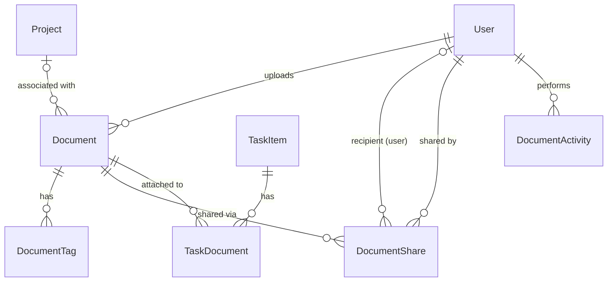

# Data Model: Document Upload and Management

**Feature**: `001-document-upload-management` | **Date**: 2026-10-20 | **Plan**: [plan.md](plan.md)

Conventions (Constitution IV, [research.md](research.md) R9): integer identity keys, text categories, UTC timestamps, schema created by `EnsureCreated()` (delete `ContosoDashboard.db` after pulling).

## New entities

### Document

| Field | Type | Rules |
|---|---|---|
| DocumentId | int, PK, identity | — |
| Title | string(255) | Required, trimmed, non-empty |
| Description | string(2000)? | Optional |
| Category | string(50) | Required; one of `DocumentCategories.All`: "Project Documents", "Team Resources", "Personal Files", "Reports", "Presentations", "Other" |
| OriginalFileName | string(255) | Required; display/download name only (never used in paths) |
| FileType | string(255) | Required; MIME type derived server-side from extension (R6) |
| FileExtension | string(10) | Required; lower-case, from allow-list |
| FileSizeBytes | long | 1 … 26,214,400 |
| StoragePath | string(500) | Required, **unique**; `{uploaderId}/{projectId\|personal}/{guid}{ext}`; generated before file write |
| UploadedByUserId | int, FK → User | Required; `OnDelete: Restrict` |
| ProjectId | int?, FK → Project | Optional; uploader must be member/PM at time of association; `OnDelete: SetNull` |
| UploadedDate | DateTime (UTC) | Set on create |
| LastModifiedDate | DateTime (UTC) | Set on create, metadata edit, replace |

Indexes: `UploadedByUserId`, `ProjectId`, `Category`, `UploadedDate`, unique `StoragePath`.
Navigation: `UploadedByUser`, `Project`, `Tags`, `Shares`, `TaskLinks`.

### DocumentTag

| Field | Type | Rules |
|---|---|---|
| DocumentTagId | int, PK | — |
| DocumentId | int, FK → Document | Cascade delete |
| Tag | string(50) | Required, trimmed, stored lower-case; max 10 per document; unique per (DocumentId, Tag) |

Indexes: `Tag`; unique `(DocumentId, Tag)`.

### DocumentShare

| Field | Type | Rules |
|---|---|---|
| DocumentShareId | int, PK | — |
| DocumentId | int, FK → Document | Cascade delete |
| SharedWithUserId | int?, FK → User | Exactly one of SharedWithUserId / SharedWithDepartment is set; `OnDelete: Cascade` |
| SharedWithDepartment | string(100)? | Matches `User.Department` values |
| SharedByUserId | int, FK → User | Must equal Document.UploadedByUserId; `OnDelete: Restrict` |
| SharedDate | DateTime (UTC) | Set on create |

Rules: no duplicate share for same (DocumentId, SharedWithUserId) or (DocumentId, SharedWithDepartment); cannot share with self. Revoking = deleting the row (FR-022a).
Indexes: `SharedWithUserId`, `SharedWithDepartment`, `DocumentId`.

### TaskDocument

| Field | Type | Rules |
|---|---|---|
| TaskDocumentId | int, PK | — |
| TaskId | int, FK → TaskItem | Cascade delete |
| DocumentId | int, FK → Document | Cascade delete |
| AttachedByUserId | int, FK → User | `OnDelete: Restrict` |
| AttachedDate | DateTime (UTC) | — |

Rules: unique `(TaskId, DocumentId)`. On attach, if the task has a ProjectId and the document has none, set `Document.ProjectId = Task.ProjectId` (FR-029). If the document is already associated with a different project, attach is rejected with a message.

### DocumentActivity

| Field | Type | Rules |
|---|---|---|
| DocumentActivityId | int, PK | — |
| DocumentId | int | **No FK** (records survive deletion) |
| DocumentTitle | string(255) | Snapshot at time of action |
| FileType | string(255) | Snapshot (for "most uploaded types" report) |
| ActorUserId | int, FK → User | `OnDelete: Restrict` |
| Action | string(30) | One of `DocumentActions`: Upload, Preview, Download, MetadataEdit, Replace, Delete, Share, RevokeShare, AttachToTask, ScanRejected |
| Details | string(500)? | e.g., share recipient, rejection reason |
| OccurredAt | DateTime (UTC) | — |

Indexes: `OccurredAt`, `Action`, `ActorUserId`, `DocumentId`.

## Changes to existing entities

| Entity | Change |
|---|---|
| `NotificationType` enum | Append `DocumentShared`, `DocumentAdded` (append-only to keep stored values) |
| `ApplicationDbContext` | Add `DbSet`s for the five entities; configure keys, indexes, delete behaviors, unique constraints above |
| `User` | No schema change; `Department` defines team membership (FR-025). Optional navigation `UploadedDocuments` |
| `DashboardSummary` (service DTO) | Add `DocumentCount` |
| Login claims | Add `"Department"` claim (not a schema change) |
| Seed data | Add user 5 “Mateo Rossi” (`mateo.rossi@contoso.com`, Employee, Marketing, not a project member) so deny paths and cross-department sharing can be validated (SC-005) |

## Derived rules (authorization)

See [research.md](research.md) R7. Summarized as capabilities per document for a requesting user `U`:

| Capability | Granted when |
|---|---|
| View / preview / download | U is Administrator · uploader · PM of project · member of project · direct share recipient · U.Department = share department · (U is TeamLead ∧ U.Department = uploader.Department) |
| Edit details / replace / delete | U is Administrator · uploader · PM of document's project · (U is TeamLead ∧ U.Department = uploader.Department) |
| Share / revoke share | U is uploader |
| Attach to task | U can view the document ∧ U can view the task (assignee, creator, or member/PM of task's project) |

Null departments never match (users without a department have no team).

## State transitions

```mermaid
stateDiagram-v2
    [*] --> Validating: user submits file
    Validating --> Rejected: type/size/empty/scan fails
    Validating --> Stored: file written to storage path
    Stored --> Active: DB record saved
    Stored --> Rejected: DB save fails (file removed)
    Active --> Active: metadata edit / replace / share / revoke / attach
    Active --> [*]: delete confirmed (record + file removed; activity retained)
    Rejected --> [*]
```

